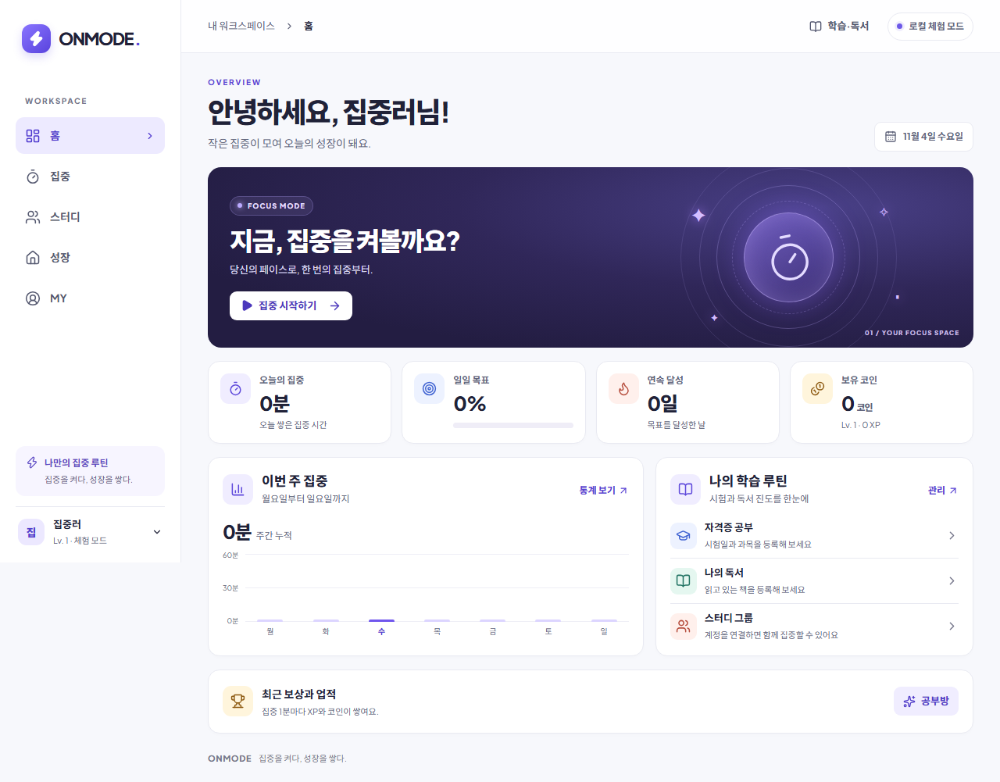

# ONMODE · 온모드

**집중을 켜다, 성장을 쌓다.** 자격증 공부와 독서 시간을 기록하고, 집중해서 얻은 코인으로 나만의 2D 공부방을 꾸미는 웹 앱입니다.



## 로컬에서 바로 실행

Node.js **22.22 이상**이 필요합니다. PowerShell에서 스크립트 실행 정책으로 `npm`이 차단되면 `npm.cmd`를 사용하세요.

```bash
npm ci
npm run dev
```

터미널의 로컬 주소(기본 `http://127.0.0.1:5173`)를 여세요. Supabase 설정 없이도 체험 기록이 IndexedDB에 저장됩니다. `localhost`와 `127.0.0.1`은 브라우저 저장 공간이 다르므로 같은 주소를 사용하세요.

1. **학습·독서**에서 자격증과 과목 또는 도서를 등록하고 **집중하기**를 누릅니다.
2. 빠르게 확인하려면 **사용자 지정**에서 1분 집중, 0분 휴식을 설정하고 시작합니다.
3. 1분을 완료하면 5 XP와 1코인이 쌓입니다. **성장**에서 새벽 조명을 구매하고 배치합니다.
4. **홈**과 **MY**에서 오늘의 집중 시간과 기록을 확인한 뒤 새로고침합니다.

**MY → 환경설정 → 화면 테마**에서 **밝게**, **어둡게**, **시스템**을 선택할 수 있습니다. 선택은 현재 브라우저에 저장됩니다.

## 계정과 스터디 연결

로컬 Docker 환경에서 [Supabase CLI](https://supabase.com/docs/guides/local-development/cli/getting-started)를 실행합니다. ONMODE는 다른 프로젝트의 기본 포트와 겹치지 않도록 API **56321**, DB **56322**, Mailpit **56324**를 사용합니다.

```bash
npx supabase@3.0.0 start
npx supabase@3.0.0 status
```

`.env.example`을 `.env.local`로 복사하고 API URL과 **Publishable key**를 입력한 다음 Vite를 다시 실행하세요. `sb_secret_…`이나 service_role 키는 입력하지 마세요. 로컬 설정은 테스트를 위해 이메일 확인을 생략합니다. 호스팅 환경에서는 이메일 확인과 리디렉션 URL을 설정하세요. 로컬 체험 기록과 계정 기록은 별도로 보관됩니다.

**비밀번호 재설정:** 계정 화면에서 **비밀번호를 잊었나요?**를 누르세요. 로컬 개발에서는 실제 이메일 대신 [Mailpit](http://127.0.0.1:56324/)에 링크가 도착합니다. 요청할 때 사용한 브라우저와 사이트 주소에서 링크를 열고 새 비밀번호를 설정하세요. 메일을 연 뒤 페이지를 새로고침하거나 닫았다면 다시 요청해야 합니다.

**계정 삭제:** 로그인한 상태에서 **MY → 계정 관리 → 계정 삭제 시작**을 선택하세요. 현재 비밀번호와 확인 문구를 입력하면 계정과 서버의 개인 기록이 영구 삭제됩니다. 다른 멤버가 있는 그룹은 가입 순서에 따라 그룹장이 바뀌며, 마지막 멤버가 삭제되면 그룹도 삭제됩니다. 브라우저 체험 기록은 별도로 유지됩니다.

**스터디 챌린지:** 스터디를 열고 그룹장 계정에서 **챌린지 만들기**를 누르세요. 이름·공동 집중 목표·기간을 정하면 멤버 모두 함께 도전합니다. 챌린지 생성·시작 이후 시작해서 종료일 안에 마친 집중만 합산하며, 멤버별 기여 시간도 볼 수 있습니다. 기간은 그룹장이 만들 때 선택한 시간대 기준으로 종료일을 포함합니다. 그룹장은 종료 전 취소할 수 있고, 결과 기록은 남습니다.

**스터디 공지:** 그룹장은 **그룹 공지 → 공지 작성**에서 소식과 규칙을 남길 수 있습니다. 제목을 누르면 내용을 열고, 그룹장은 수정·삭제할 수 있습니다. 공지는 작성일 기준 최신순으로 표시되며 **이전 공지 더 보기**로 계속 조회할 수 있습니다. 다른 기기에서 먼저 수정한 내용은 오래된 초안으로 덮어쓰지 않습니다. 그룹장 이관이나 계정 삭제 후에도 공유 그룹의 공지는 남아 새 그룹장이 관리합니다.

**그룹 채팅:** 그룹을 선택한 뒤 **그룹 채팅**에서 메시지를 보내세요. Enter는 줄바꿈, Ctrl/⌘+Enter는 전송입니다. 이전 대화를 더 불러올 수 있고, 과거 대화를 읽는 동안 새 메시지가 오면 **새 메시지 보기**로 이동합니다. 전송 실패 시 입력 내용이 유지되며 재시도해도 중복 저장되지 않습니다. 본인 메시지는 직접 삭제할 수 있고 그룹장은 멤버 메시지도 삭제할 수 있습니다. 계정을 삭제하면 그 사용자가 보낸 채팅도 삭제됩니다.

운영 전에는 Supabase Auth의 **Site URL**을 앱 주소로 설정하고, 동일한 도메인의 정확한 `/account/recovery` URL을 [리디렉션 허용 목록](https://supabase.com/docs/guides/auth/redirect-urls)에 추가하세요. 재설정 메일 템플릿에서 `{{ .ConfirmationURL }}`을 사용하고 운영 SMTP로 실제 수신과 재로그인을 검증하세요.

운영 환경을 연결할 때는 승인된 Supabase 프로젝트에 [마이그레이션](supabase/migrations)과 환경변수를 적용하고, Vercel의 Vite 설정으로 `dist`를 배포할 수 있습니다. SPA 경로는 [vercel.json](vercel.json)에서 처리합니다. 이 저장소에는 원격 프로젝트 주소나 키를 포함하지 않습니다.

## 검증

```bash
npm run lint
npm run typecheck
npm test
npm run build
npx playwright install chromium
npm run test:e2e
npm run test:db
npm run test:connected
```

`test:e2e`는 별도 포트에서 Supabase 없이 데스크톱과 모바일 Chromium을 실행합니다. `test:db`와 `test:connected`는 Docker의 ONMODE 전용 로컬 스택과 56321 API에만 연결하며, 테스트 계정과 그룹을 생성해 확인한 뒤 삭제합니다. 연결 테스트를 재현하려면 로컬 스택과 마이그레이션이 준비되어 있어야 합니다.

## 모바일 확장

[Capacitor](https://capacitorjs.com/docs/getting-started)는 같은 웹 빌드(`dist`)를 사용합니다. 모바일 개발 환경을 준비한 후 동일한 Capacitor 버전의 Android/iOS 패키지를 설치하고 `npx cap add android` 또는 macOS에서 `npx cap add ios`를 실행합니다. 다음부터는 `npm run build`와 `npx cap sync`로 동기화합니다. 네이티브 프로젝트, 알림, 이메일 인증 딥 링크는 후속 작업입니다.

- [아키텍처](docs/ARCHITECTURE.md) · [기능 명세](docs/FEATURES.md) · [데이터베이스](docs/DATABASE.md)
- [로드맵](docs/ROADMAP.md) · [진행 현황과 테스트 결과](docs/PROGRESS.md) · [개발 규칙](AGENTS.md)
