# ONMODE · 온모드

**집중을 켜다, 성장을 쌓다.** 개인공부와 독서를 기록하고, 집중으로 얻은 코인으로 2D 공부방을 꾸미는 앱입니다. 스터디에서는 멤버들과 목표를 세우고 집중과 독서 진도를 함께 쌓을 수 있습니다.

웹 MVP와 주요 스터디 기능을 구현했습니다. 데스크톱·모바일 브라우저와 로컬 Supabase에서 검증했으며, 운영 웹 배포와 네이티브 앱은 다음 단계입니다.


## 구현한 기능

| 영역 | 현재 사용할 수 있는 기능 |
| --- | --- |
| 홈·MY | 일·주·월·전체 집중 통계, 목표 달성률과 연속 달성, 시험 D-day와 독서 진도. 집중 기록을 기간·활동·방식으로 필터링하고 최근순 또는 오래된순으로 20개씩 조회 |
| 집중 | 뽀모도로, 플로우타임, 50/10, 사용자 지정 타이머. 활동 연결, 일시정지·재개, 새로고침 뒤 복원과 자동 완료. 집중 1분당 5 XP와 1코인 지급 |
| 나의 공부·서재 | 시험일 없는 개인공부와 자격증별 과목 관리. 학습 메모, 독서 목표·진도·노트. ISBN·제목·저자 검색, 판본 선택, 카메라·사진 바코드 인식과 직접 등록 |
| 스터디 | 공개 그룹 검색·가입, 초대 전용 그룹, 탈퇴와 그룹장 이관. 실시간 집중 상태, 일간·주간 랭킹, 기간별 집중 챌린지, 그룹 업적 6종과 월간 시즌 |
| 공지·채팅 | 그룹 공지, 실시간 메시지 전송·수정·삭제, 읽음 인원. 멤버 전용 사진 미리보기와 파일 다운로드 |
| 공부방·공동 도서관 | 코인으로 아이템을 구매하고 위치·겹침 순서·회전·크기를 편집. 멤버가 함께 공간을 꾸미고 공동 도서를 개인 서재에 가져오기. 공유 독서 목표와 기간별 독서 도전 |
| 계정·설정 | 브라우저 체험, 이메일 회원가입·로그인·로그아웃, 비밀번호 재설정, 계정 삭제. 밝게·어둡게·시스템 테마와 앱을 열어 둔 동안의 집중 완료 알림 |

## 기능별 화면

실제 로컬 앱에서 예시 데이터로 캡처한 데스크톱·모바일 화면입니다. 이미지를 누르면 원본 크기로 볼 수 있습니다.

<details open>
<summary><strong>집중 타이머와 기록</strong></summary>

활동을 연결해 타이머를 시작하고, 집중 화면의 **기록 보기**에서 기간별 기록과 합계를 확인합니다.

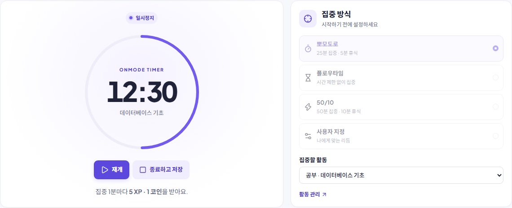

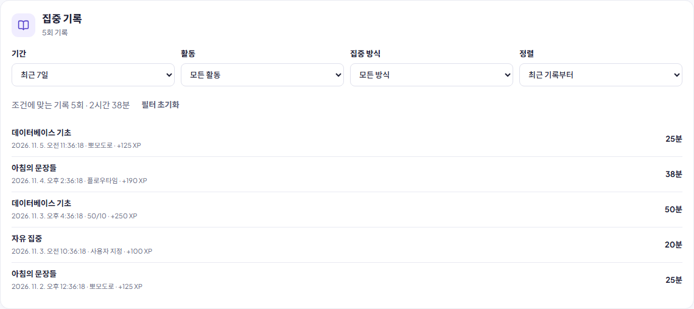

</details>

<details>
<summary><strong>나의 공부와 도서 등록</strong></summary>

| 개인공부 등록 | 제목·저자 검색 |
| --- | --- |
| 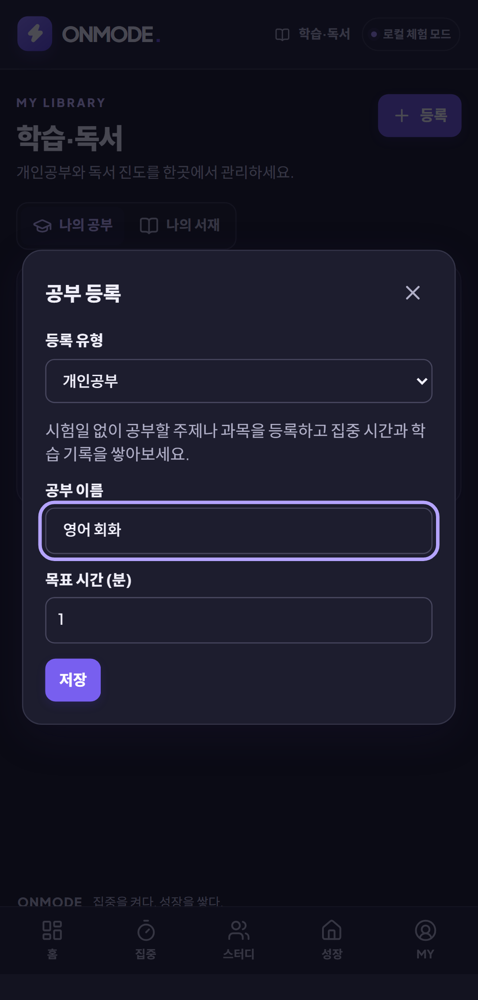 | 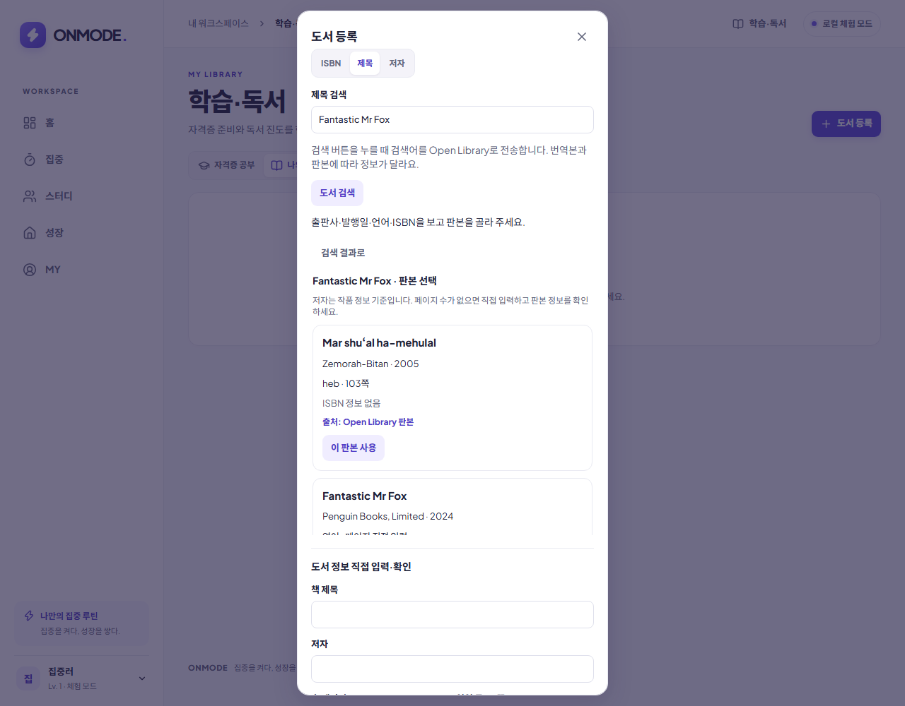 |

[ISBN 조회 화면](docs/assets/book-isbn.png) · [모바일 바코드 인식 화면](docs/assets/book-barcode.png)

</details>

<details>
<summary><strong>스터디 검색, 시즌, 업적</strong></summary>

| 공개 그룹 검색 | 월간 스터디 시즌 |
| --- | --- |
| 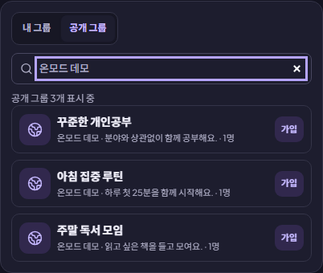 | 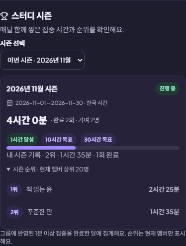 |

[그룹 업적 화면](docs/assets/group-achievements.png) · [10인 동시 사용 검증](docs/TEST_10_USERS.md)

</details>

<details>
<summary><strong>그룹 채팅과 첨부</strong></summary>

| 읽음 인원 | 사진·파일 첨부 |
| --- | --- |
| 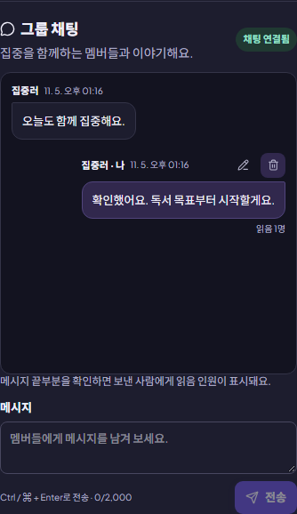 | 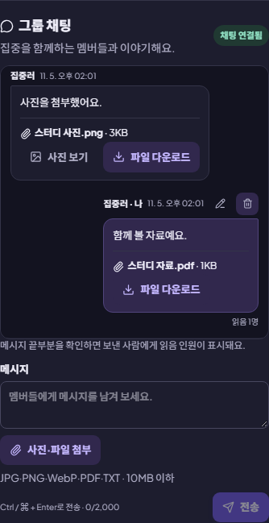 |

메시지마다 10MB 이하 JPG·PNG·WebP·PDF·TXT 파일을 하나 보낼 수 있습니다.

</details>

<details>
<summary><strong>공부방과 공동 도서관</strong></summary>

| 멤버가 꾸민 공동 도서관 | 기간별 독서 도전 |
| --- | --- |
| 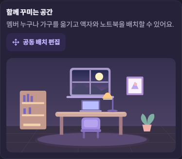 | 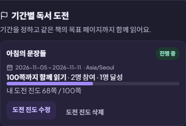 |

[개인 공부방의 가구 회전·크기 편집](docs/assets/room-transforms.png) · [공유 독서 목표](docs/assets/shared-reading-goals.png)

</details>

<details>
<summary><strong>계정과 화면 테마</strong></summary>

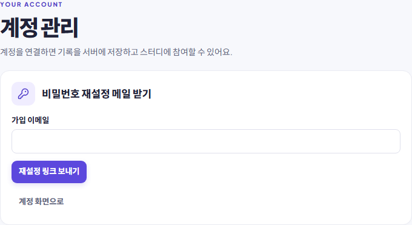

[다크 테마 홈 화면](docs/assets/dashboard-dark.png)

</details>

## 로컬 실행

Node.js **22.22 이상**이 필요합니다. PowerShell에서 실행 정책으로 `npm`이 차단되면 `npm.cmd`를 사용하세요.

```bash
npm ci
npm run dev
```

[온모드 열기](http://127.0.0.1:5173/)에서 바로 체험할 수 있습니다. 체험 기록은 현재 브라우저의 IndexedDB에 저장됩니다. `localhost`와 `127.0.0.1`의 저장 공간은 서로 다르므로 같은 주소를 사용하세요.

1. **학습·독서**에서 개인공부 또는 도서를 등록하고 **집중하기**를 누릅니다.
2. **사용자 지정**에서 집중 1분과 휴식 0분을 설정한 뒤 시작합니다.
3. 완료 후 **성장**에서 코인으로 조명을 구매하고 배치합니다.
4. **홈**과 **MY → 집중 기록**에서 결과를 확인합니다. **MY → 환경설정**에서 화면 테마를 선택할 수 있습니다.

### 계정과 스터디 연결

Docker를 실행한 뒤 Supabase 로컬 스택을 시작합니다. ONMODE는 API **56321**, DB **56322**, Mailpit **56324**를 사용합니다.

```bash
npx supabase@3.0.0 start
npx supabase@3.0.0 status
```

`.env.example`을 `.env.local`로 복사하고 로컬 API URL과 **Publishable key**를 입력한 뒤 Vite를 다시 실행하세요. 서버 전용 키는 프런트엔드 환경 파일에 넣지 마세요. 체험 기록과 계정 기록은 별도로 보관됩니다.

- 계정 화면의 **비밀번호를 잊었나요?**에서 재설정을 요청하세요. 로컬에서는 같은 브라우저에서 받은 링크를 열어야 합니다. [Mailpit 열기](http://127.0.0.1:56324/)
- **MY → 계정 관리 → 계정 삭제 시작**에서 현재 비밀번호와 확인 문구를 입력하면 서버의 개인 기록이 삭제됩니다. 멤버가 남아 있는 그룹은 그룹장이 이관됩니다.
- 채팅 첨부를 사용하는 로컬 환경에서는 Storage를 켜고 별도 터미널에서 `npm run dev:files`를 실행하세요. 취소·만료·삭제된 첨부를 한 번만 정리하려면 `npm run dev:files -- --once`를 사용합니다.

### 도서 등록과 공간 편집

**나의 서재 → 도서 등록**에서 ISBN이나 제목·저자로 검색한 뒤 선택한 도서 정보를 확인하고 저장합니다. 카메라 또는 12MB 이하 JPG·PNG·WebP 사진으로 EAN-13 도서 바코드를 읽을 수 있습니다. 영상과 사진은 기기 안에서 처리하며, 카메라는 HTTPS 또는 같은 기기의 로컬 주소에서 사용할 수 있습니다. 검색 결과가 없거나 카메라를 사용할 수 없으면 직접 등록할 수 있습니다. [도서 검색 출처](https://openlibrary.org/dev/docs/api/books)

**성장 → 배치 편집** 또는 **스터디 → 공동 도서관 → 공동 배치 편집**에서 가구를 끌거나 방향 버튼·화살표 키로 움직입니다. 겹침 순서는 화면 버튼이나 Page Up·Page Down으로 바꿀 수 있습니다. 공동 도서는 **내 서재로 가져오기**로 개인 기록과 연결됩니다. [기능 명세](docs/FEATURES.md)

## 검증

| 항목 | 확인 결과 |
| --- | --- |
| 코드 검사 | ESLint, TypeScript strict, Vite 프로덕션 빌드 통과 |
| 단위 테스트 | 29개 통과 |
| 체험 모드 브라우저 | 데스크톱·모바일 Chromium 전체 36개 통과 |
| 계정·스터디 | 로컬 Supabase에서 기능별 연결 테스트 및 임시 계정 10개의 동시 사용 시나리오 확인 |

```bash
npm run lint
npm run typecheck
npm test
npm run build
npx playwright install chromium
npm run test:e2e
npm run test:db
npm run test:connected
```

`test:e2e`는 Supabase 없이 실행합니다. `test:db`와 `test:connected`는 ONMODE 전용 로컬 스택과 적용된 마이그레이션이 필요합니다. [상세 검증 기록](docs/PROGRESS.md)

## 남은 작업

1. **운영 웹 베타** — 운영 Supabase 프로젝트와 Vercel 연결, DB 마이그레이션 적용, 실제 가입·비밀번호 재설정 메일과 인증 리디렉션 검증.
2. **운영 관리** — 첨부 파일 정리 작업 예약, 오류 모니터링, DB·첨부 백업과 복구 절차 마련.
3. **실기기 검증** — 실제 휴대폰에서 카메라 권한과 바코드 인식, 접근성 및 사용성 확인.
4. **Android·iOS 앱** — Capacitor 네이티브 프로젝트 생성, 백그라운드 타이머 복원, 로컬 알림, 이메일 인증 링크로 앱 열기, 서명과 스토어 심사 준비.
5. **출시 후 확장** — 상용 도서 검색의 이용 조건·처리량 검토, 프리미엄 구독·결제, 고급 꾸미기 콘텐츠와 AI 분석.

### 운영과 모바일 준비

웹 배포는 Vite 빌드의 `dist`를 사용합니다. 운영 Supabase Auth의 Site URL과 허용 목록에 앱의 정확한 `/account/recovery` 주소를 설정하고, 운영 SMTP로 실제 수신과 재로그인을 확인합니다. [배포 설정](vercel.json) · [DB 마이그레이션](supabase/migrations)

Capacitor는 같은 `dist`를 사용합니다. 네이티브 환경과 같은 버전의 Android·iOS 패키지를 준비한 후 `npx cap add android` 또는 macOS에서 `npx cap add ios`로 프로젝트를 생성합니다. 웹 변경은 `npm run build`와 `npx cap sync`로 동기화합니다. [Capacitor 설정](capacitor.config.ts)

## 개발 문서

[기능 명세](docs/FEATURES.md) · [아키텍처](docs/ARCHITECTURE.md) · [데이터베이스](docs/DATABASE.md) · [로드맵](docs/ROADMAP.md) · [진행 현황과 테스트 결과](docs/PROGRESS.md) · [개발 규칙](AGENTS.md)
