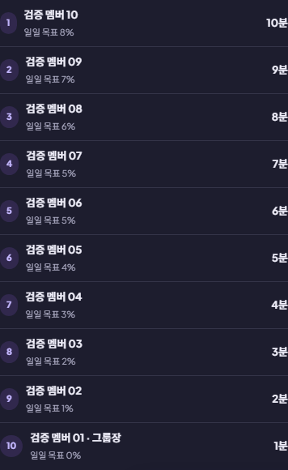

# 스터디 10인 검증 · 2026-11-04

ONMODE 전용 로컬 Supabase와 웹 앱에서 임시 계정 10개, 독립 브라우저 세션 10개, 그룹 2개로 검증했습니다. 데스크톱 5개와 모바일 Chromium 5개를 사용했습니다. 시나리오는 18.2초에 통과했고, 생성한 계정과 그룹은 모두 정리했습니다.

## 결과

| 검사 | 확인 결과 |
| --- | --- |
| 계정 분리 | 서로 다른 사용자 ID 10개와 각 브라우저의 본인 프로필 확인 |
| 공개 그룹 | 검색·가입 후 10명 참여 확인 |
| 비공개 그룹 | 미가입자에게 목록·초대 코드 비공개, 일반 가입 차단, 초대 후 10명 참여 |
| 재시도 | 초대 재참여 후 멤버 수 10명 유지 |
| 인가 | 미가입·익명 사용자의 랭킹·공지·챌린지·채팅·도서관 조회 차단. 일반 멤버 9명의 목표·공지·챌린지 관리 차단 |
| 공지 | 그룹장 작성 공지를 10개 화면에서 수신 |
| 채팅 | 계정별 동시 전송 10건과 반복 전송을 실행해 발신자 10명·메시지 10개 유지. 모든 화면에서 수신 |
| 집중 상태 | 10명 집중 → 5명 일시정지 → 10명 재개 → 전원 종료가 모든 화면에 반영 |
| 기록·보상 | 계정별 집중 기록 1개, 완료 요청 재시도 후에도 합계 55코인·275 XP 유지 |
| 랭킹·챌린지 | 그룹 총합·주간 합계가 서버 개인 기록 합계와 일치. 10명 순위와 공동 챌린지 목표 달성 확인 |
| 공동 도서 | 공유 도서 1개를 10명에게 표시. 가져오기 반복 후 개인 서재별 도서 1개 유지, 개인 진도·노트 분리 |
| 공동 편집 | 동일 버전으로 10명 동시 저장 시 1명 성공·9명 충돌. 성공 요청 재시도 후 버전 1 유지, 10개 화면에 결과 반영 |
| 탈퇴·재가입 | 탈퇴 후 조회·공유 자료 접근 차단. 재가입 후 이전 개인 기여는 새 가입 기간 랭킹에서 제외하고 그룹 누적은 유지 |
| 그룹장 이관 | 가장 먼저 가입한 멤버에게 이관. 새 그룹장의 목표 수정과 이전 그룹장의 일반 멤버 재가입 확인 |
| 정리 | 전원 탈퇴 후 빈 그룹 및 공지·채팅·공동 도서·배치 제거. 개인 서재 보존 확인 후 임시 계정 10개도 삭제. 잔여 임시 계정·그룹 0개 |



## 방법과 범위

API는 `127.0.0.1:56321`, 테스트 웹 앱은 `127.0.0.1:5182`에 연결했습니다. 가입·로그인·그룹 명령·Realtime은 실제 로컬 서비스로 실행했습니다. 사용자별 이메일·비밀번호·인증 토큰은 메모리에만 두며 보고서와 테스트 결과에 기록하지 않습니다. 이미지의 닉네임은 테스트 전용 표시 이름입니다.

집중 시간은 오래 기다리는 대신 임시 집중 행의 활성 시각을 로컬 DB에서 65~605초 전으로 조정했습니다. 클라이언트 완료 요청에는 시간·XP·코인을 보내지 않았으며, 서버가 계산한 기록과 보상을 대조했습니다. 운영 환경의 처리량·네트워크 지연은 별도 측정 범위입니다.

애플리케이션 기능 결함은 발견하지 않았습니다. 이번 변경은 검증 코드와 문서이며 운영 DB·배포 설정은 변경하지 않았습니다.

## 재실행

로컬 Supabase와 마이그레이션을 준비한 뒤 실행합니다. 테스트는 로컬 API 주소를 검사하고, 성공·실패 모두 생성한 계정과 그룹을 정리합니다.

```bash
npm run test:connected -- tests/connected/tenUsers.spec.ts --workers=1
```

린트와 TypeScript strict 검사도 통과했습니다. 이 시나리오는 기존 연결 테스트 묶음에 포함되어 전체 실행 시에도 수행됩니다.
